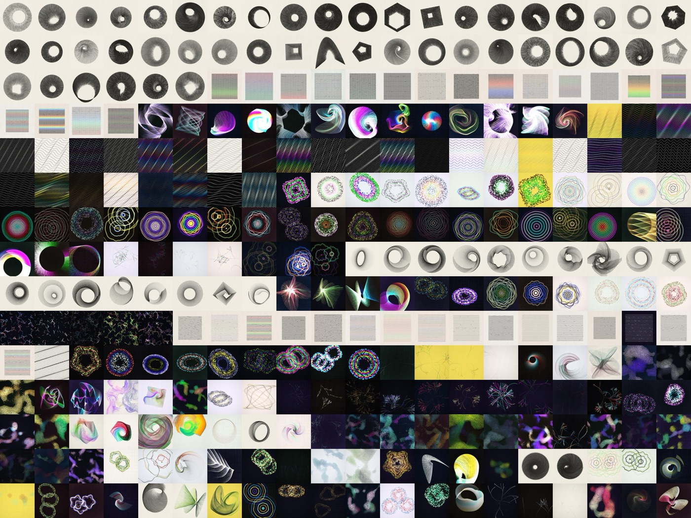

# wake

**A living drawing instrument.** Thousands of line-heads move through fields of force and leave their trace. Every visit opens a new design from a collection of 100,000: flocks, orbits, Riley-style waves, Martin-style grids, branching growth. Six real science pieces simulate their actual equations: the Lorenz attractor, double-pendulum chaos, the figure-eight three-body orbit, Kuramoto fireflies, Chladni plates and Turing patterns.

**[Open wake →](https://wake-black.vercel.app)** · [How it was made (case study)](https://wake-black.vercel.app/case.html) · [Credits & sources](https://wake-black.vercel.app/credits.html) · [Research repo](https://github.com/preet-portfolio/wake-research)



## What you can do

- **✦ new**, a tap or **space**: a new design. Species come from a shuffled deck, so the same behaviour never appears twice in a row.
- **Drag** to stir, **hold** to pull, **right-drag** or **shift** to push. Tilting a phone tips the flow.
- **ⓘ** on a science piece: one sentence, the equation, the primary source, and one control that shows the idea. Raise the coupling and the fireflies synchronise; drop ρ below 13.93 and Lorenz's chaos disappears.
- **edit**: every parameter, and for classic designs an ordered stack of force blocks.
- **plot**: freeze time and save the current trails as an SVG for a pen plotter, with an estimated plot time and ink density.
- **Links**: `#n=48213` is a fixed design from the collection; `#s=…` is any edited state.

## How it works

| Layer | Files | What it does |
|---|---|---|
| Model | `src/model.ts`, `src/state.ts` | Plain-data state (species, forces, style), serialised to the URL and validated: links are untrusted input. |
| Collection | `src/design.ts` | Number → species → parameters, from a seeded generator. Candidates are judged on the CPU only, so a number gives the same design on every device. |
| Motion | `src/field.ts`, `src/sim.ts`, `src/species.ts` | A fixed-step simulation. Blocks act as forces (including curl noise); species add their own behaviours (Boids flocking, Kepler-like orbits, waves, grids, growth, pulses, constellations). |
| Science | `src/science/*.ts`, `src/species-science.ts`, `src/grayscott-gl.ts` | Solvers shared by the visuals and the tests: RK4, velocity Verlet, mean-field Kuramoto, and Gray–Scott on the GPU. |
| Rendering | `src/gl.ts` | WebGL2: instanced quads into half-float trail buffers that fade each frame, highlight roll-off, and clip-aware automatic exposure. |
| App | `src/main.ts`, `src/panel.ts` | Device tiering from measured frame time, pointer and tilt forces, the ⓘ cards (KaTeX), and exports. |

The original "still" drawing engine (`src/engine.ts`) is kept for exact, deterministic renders (`?still`), plot export and regression tests.

## Proof

All of these are automated, in `tests/`:

| Claim | Evidence |
|---|---|
| The science is right | Lorenz Lyapunov exponent 0.90 (published ≈ 0.9056). Double-pendulum energy drift 8 × 10⁻⁶ over 10,000 RK4 steps. Figure-eight drift 2 × 10⁻⁷ (Verlet), and it closes after T = 6.32591398. Kuramoto r = √(1 − K꜀/K) to 0.001. Gray–Scott spots, labyrinth and extinction at Pearson's (F, k). |
| GPU = CPU | Gray–Scott on the GPU against the CPU reference from the same start: correlation 1.0000. |
| It's alive | Visible motion within 1 s of every fresh visit. For 60 s, at least 33 % of pixels change every second on a GPU, and on software rendering too. 60 fps at 20,000 segments (M1 GPU, Pixel 7 emulation). |
| Variety | On 300 sampled designs, inward-streaming (the "waterfall") fell from 61 % to 28 %. 100 presses of ✦ new: no repeats, every species appears. |
| Determinism | Byte-identical SVG per state, and identical designs in Node and in the browser. |
| Safe links | A hostile link is clamped and escaped, and can't freeze the tab or inject markup. |
| It's mine | A token-level copy check against uji's original source finds 0 clones (`npm run jscpd`). |
| It plots | 100 of 100 sampled ink designs fit the plot budget (≤ 45 min, density ≤ 1.5). |

Still waiting on people: an expert review of the science cards (`docs/science-review-checklist.md`), a 60-second comprehension test, a card-sort test and a first-use test (`docs/`).

## Run

```sh
npm install
npx vite            # http://localhost:5173 (add ?fps for the frame meter)
npm run build       # static site in dist/
```

## Checks

```sh
npx playwright install chromium
npx playwright test                 # everything: about 70 tests, about 6 minutes
npx playwright test science         # solver correctness against published values
npx playwright test alive           # 60 s motion check on GPU and software rendering → reports/alive.json
npx playwright test fps video       # → reports/fps.json, reports/videos/
npm run jscpd                       # copy check against uji → reports/jscpd/verdict.json
```

GPU tests launch full Chromium (`channel: "chromium"`): since Playwright 1.5x the default headless shell renders in software.

## Credit

Inspired by [uji](https://github.com/doersino/uji) by Noah Doersing, credited throughout. wake shares no code with it. Every paper, artwork and tool it draws on is listed with citations in [credits.html](https://wake-black.vercel.app/credits.html). Made by Preet Panchal, built with [Claude Code](https://claude.com/claude-code).

## License

[MIT](LICENSE). Fonts (Instrument Serif, IBM Plex Mono) are under the SIL Open Font License and served by Google Fonts.
